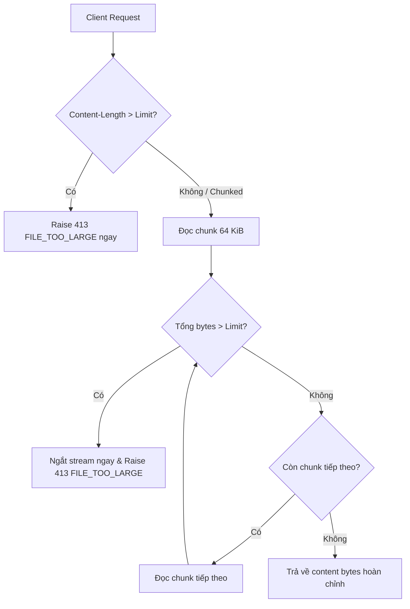

# Kế hoạch triển khai: Phase 4 — Tăng cường độ bền vững và đóng gói (Robustness and Packaging)

- **Trạng thái:** Đề xuất
- **Đặc tả liên quan:** `docs/product/requirements.md` (FR-01, FR-06, NFR-01, NFR-02, NFR-03, NFR-06), `docs/architecture/architecture.md` (Mục 7 & 8), `docs/architecture/api-contract.md`
- **Issue liên quan:** Phase 4 trong `docs/development/roadmap.md`

## 1. Kết quả khảo sát repository

- **Khảo sát bằng CodeGraph và đọc mã nguồn:**
  - `app/core/config.py`: Đã có `Settings` với `max_upload_size_bytes = 10 * 1024 * 1024` (10 MiB mặc định). Chưa có cấu hình cho logging (`log_level`, `log_json_format`).
  - `app/core/correlation.py`: Đã có `CorrelationIdMiddleware` sinh và truyền `X-Correlation-ID` qua context variable `_correlation_id_ctx`. Tuy nhiên, chưa có cơ chế đưa correlation ID này vào hệ thống log một cách tự động.
  - `app/core/logging.py`: Chưa tồn tại. Các module hiện đang dùng `logging.getLogger(__name__)` mặc định của Python, phát ra plain text unstructured logs không có `correlation_id` đồng nhất.
  - `app/api/routes/documents.py`: Hiện đang dùng `content = await file.read()`. Phương thức này đọc toàn bộ file vào bộ nhớ trước khi `DocumentService` kiểm tra kích thước. Nếu client tải lên file 1 GB, server sẽ nạp toàn bộ 1 GB vào bộ nhớ trước khi ném lỗi 413, vi phạm tiêu chí chấp nhận số 86 và NFR-03 ("Một upload quá kích thước bị từ chối mà không đọc payload không giới hạn vào bộ nhớ").
  - `app/services/document_service.py`: Đã kiểm tra kích thước sau khi nạp `len(content)`. Cần hỗ trợ bounded streaming và bổ sung logging có cấu trúc chỉ chứa metadata an toàn (kích thước, định dạng, thời gian xử lý), tuyệt đối không log nội dung tài liệu.
  - Docker & Containerization: Chưa có `Dockerfile` và `.dockerignore`.
  - CI Workflow (`.github/workflows/ci.yml`): Đã chạy lint, format check và pytest, nhưng chưa có bước build kiểm tra `Dockerfile`.
  - Tài liệu vận hành: `docs/operations/development-setup.md` chưa có hướng dẫn chạy Docker, cấu hình biến môi trường production và health check probes.
- **Ràng buộc:**
  - Tuyệt đối tuân thủ NFR-01: Không ghi log bất kỳ nội dung tài liệu trích xuất (text), nội dung thô (binary), hay bí mật nào.
  - Docker runtime phải chạy với quyền **non-root user** (`appuser`, uid 10001) để đảm bảo an ninh container.
  - Phải có cơ chế kiểm tra dung lượng theo cơ chế chặn sớm (early rejection qua `Content-Length`) và bounded streaming (đọc theo chunks, hủy ngay khi vượt ngưỡng) để không bao giờ đọc dữ liệu quá cỡ không giới hạn vào RAM.

## 2. Phạm vi (Scope)

### Trong phạm vi
1. **Bounded Streaming & Upload Size Enforcement:**
   - Kiểm tra sớm header `Content-Length`: Nếu vượt `max_upload_size_bytes`, từ chối ngay với HTTP 413 `FILE_TOO_LARGE` trước khi đọc stream.
   - Triển khai tiện ích `read_upload_file_bounded(file, max_bytes, chunk_size)` trong `app/core/streaming.py`: Đọc từng chunk nhỏ (64 KiB), tích lũy dung lượng và raise ngay `AppException(413, "FILE_TOO_LARGE")` nếu vượt giới hạn mà không đọc tiếp phần còn lại vào bộ nhớ.
2. **Structured Logging & Correlation ID Injection:**
   - Tạo module `app/core/logging.py`:
     - Cung cấp `StructuredJsonFormatter` định dạng log dạng JSON 1 dòng (timestamp ISO 8601 UTC, log level, logger name, message, và tự động đính kèm `correlation_id` từ context).
     - Hỗ trợ cấu hình chuyển đổi giữa JSON format (production/cloud) và text format (local development).
     - Hàm `setup_logging(settings)` khởi tạo root logger và cấu hình các logger của Uvicorn.
   - Bổ sung cấu hình trong `app/core/config.py`: `log_level: str = "INFO"`, `log_json_format: bool = True`.
   - Ghi log vòng đời request (method, path, status_code, processing duration_ms, correlation_id) mà không log request body hay query nhạy cảm.
3. **Xác minh không log nội dung tài liệu (Zero Document Logging - NFR-01):**
   - Rà soát toàn bộ các câu lệnh log trong `app/`: Chỉ log metadata kỹ thuật an toàn (file size, format, status code, correlation_id).
   - Viết test tự động sử dụng `caplog` với canary text ("CONFIDENTIAL_CANARY_TEXT_12345") để chứng minh nội dung không bao giờ xuất hiện trong log kể cả khi thành công lẫn khi gặp lỗi.
4. **Dockerfile & Non-Root Runtime:**
   - Xây dựng `Dockerfile` chuẩn trên nền `python:3.12-slim`:
     - Tạo user non-root `appuser:appuser` (UID/GID 10001).
     - Chạy ứng dụng dưới quyền `USER appuser`.
     - Tích hợp chỉ thị `HEALTHCHECK` kiểm tra `/health`.
     - Phơi cổng mặc định 8000.
   - Tạo `.dockerignore` loại bỏ `.git`, `.venv`, cache, test fixtures, docs và secrets.
5. **CI Workflow Verification:**
   - Cập nhật `.github/workflows/ci.yml` bổ sung bước `docker build -t docuextract:test .` để đảm bảo Dockerfile luôn build thành công trên CI.
6. **Tài liệu hóa cấu hình & Vận hành:**
   - Tạo `docs/operations/service-configuration.md`: Tài liệu hóa đầy đủ các biến môi trường, định dạng structured log, chi tiết endpoint `/health` (dùng cho Kubernetes liveness/readiness probes), và hướng dẫn triển khai container.
   - Tạo `docs/architecture/decisions/ADR-002-structured-logging-and-robustness.md`.
   - Cập nhật `docs/operations/development-setup.md` và `.env.example`.

### Ngoài phạm vi (Explicit Non-Goals)
- Không triển khai các dịch vụ tập trung log phức tạp (ELK, Fluentd, OpenTelemetry collector) bên trong service.
- Không triển khai rate limiting hay authentication layer (thuộc quyền sở hữu của ASP.NET Core API hoặc API Gateway trong Phase 5+).
- Không thêm database, message queue hay redis worker.

## 3. Thiết kế

### 3.1. Luồng kiểm tra dung lượng stream (Bounded Stream Flow)



### 3.2. Cấu trúc Structured Log Record (JSON)

```json
{
  "timestamp": "2026-11-10T01:45:00.123456Z",
  "level": "INFO",
  "logger": "app.services.document_service",
  "message": "Document parsed successfully",
  "correlation_id": "8f3b2c1a0e4d...",
  "filename": "specification.docx",
  "format": "docx",
  "size_bytes": 104857,
  "duration_ms": 12.45
}
```

### 3.3. Cấu hình mới trong Settings (`app/core/config.py`)

- `log_level: str = "INFO"` (ánh xạ qua `DOCUEXTRACT_LOG_LEVEL`)
- `log_json_format: bool = True` (ánh xạ qua `DOCUEXTRACT_LOG_JSON_FORMAT`)

## 4. Các bước triển khai tuần tự

1. [ ] **Core Streaming:** Tạo `app/core/streaming.py` triển khai `read_upload_file_bounded(file, max_bytes)`.
2. [ ] **Cấu hình Settings:** Cập nhật `app/core/config.py` và `.env.example` bổ sung `log_level` và `log_json_format`.
3. [ ] **Structured Logging Module:** Tạo `app/core/logging.py` với `StructuredJsonFormatter` và hàm `setup_logging(settings)`.
4. [ ] **Tích hợp Logging & Streaming vào App:**
   - Cập nhật `app/main.py`: Gọi `setup_logging()` khi khởi tạo app.
   - Cập nhật `app/api/routes/documents.py`: Kiểm tra `Content-Length` header và gọi `read_upload_file_bounded`.
   - Cập nhật `app/services/document_service.py`: Log metadata an toàn kèm correlation ID.
5. [ ] **Đóng gói Docker:**
   - Tạo `.dockerignore`.
   - Tạo `Dockerfile` với base `python:3.12-slim`, non-root user `appuser:10001`, `HEALTHCHECK`.
6. [ ] **Cập nhật CI Workflow:**
   - Bổ sung bước kiểm tra build Docker vào `.github/workflows/ci.yml`.
7. [ ] **Viết Test:**
   - `tests/unit/test_streaming.py`: Kiểm tra chặn `Content-Length`, chặn đọc quá cỡ giữa chừng, đọc file bình thường, file rỗng.
   - `tests/unit/test_logging.py`: Kiểm tra format JSON, correlation ID tự động chèn vào log, và kiểm tra không lọt nội dung nhạy cảm (Zero Document Logging) với `caplog`.
   - `tests/integration/test_document_extract_api.py`: Thêm integration tests cho stream upload size limit.
8. [ ] **Tài liệu hóa:**
   - Tạo `docs/operations/service-configuration.md`.
   - Tạo `docs/architecture/decisions/ADR-002-structured-logging-and-robustness.md`.
   - Cập nhật `docs/operations/development-setup.md`.
   - Cập nhật `docs/development/roadmap.md`.
9. [ ] **Xác minh & Báo cáo:** Chạy `ruff check`, `ruff format --check`, `pytest`.

## 5. Kế hoạch kiểm thử

| Kịch bản | Mức độ test | Kết quả mong đợi |
| -------- | ----------- | ---------------- |
| File upload hợp lệ $\le$ 10 MiB | Unit & Integration | HTTP 200, log ra metadata kỹ thuật, có correlation ID, không log text. |
| Header `Content-Length` vượt 10 MiB | Integration | HTTP 413 `FILE_TOO_LARGE` ngay lập tức mà không đọc stream. |
| Chunked upload vượt 10 MiB giữa chừng | Unit & Integration | Ngắt stream ngay khi vượt ngưỡng, ném HTTP 413 mà không tốn thêm RAM. |
| Structured Logging sinh ra JSON | Unit | Log format chứa timestamp, level, message, correlation_id hợp lệ. |
| Không rò rỉ nội dung tài liệu ra Log (NFR-01) | Unit & Integration | Canary string ("SECRET_CANARY") xuất hiện trong text response nhưng hoàn toàn vắng mặt trong mọi log records. |
| Endpoint `/health` hoạt động | Integration | HTTP 200, trả về status="ok", có header `X-Correlation-ID`. |
| Dockerfile cú pháp và build | CI / Local | Docker build thành công, non-root user được thiết lập, CMD sẵn sàng. |

## 6. Rủi ro và biện pháp giảm thiểu

- **Rủi ro 1: Starlette UploadFile spooling file tạm ra đĩa với file lớn:**
  - *Biện pháp:* Kiểm tra header `Content-Length` trước khi nhận body, và đọc bounded streaming theo chunks giúp hủy request ngay khi vượt 10 MiB, ngăn chặn triệt để việc spam file rác ra đĩa.
- **Rủi ro 2: Log format JSON làm khó đọc khi debug cục bộ:**
  - *Biện pháp:* Cho phép tắt JSON format thông qua biến môi trường `DOCUEXTRACT_LOG_JSON_FORMAT=false` để hiển thị text thân thiện khi phát triển local.
- **Rủi ro 3: Chạy non-root trong Docker gặp lỗi quyền truy cập file:**
  - *Biện pháp:* Thiết lập quyền sở hữu `chown -R appuser:appuser /app` trong quá trình build image trước khi chuyển `USER appuser`.

## 7. Tài liệu cần cập nhật

- [x] Tạo `docs/development/plans/2026-11-10-phase-4-robustness-and-packaging.md` (Kế hoạch này)
- [ ] Tạo `docs/operations/service-configuration.md`
- [ ] Tạo `docs/architecture/decisions/ADR-002-structured-logging-and-robustness.md`
- [ ] Cập nhật `docs/operations/development-setup.md`
- [ ] Cập nhật `docs/development/roadmap.md`
- [ ] Cập nhật `.env.example`
- [ ] Tạo `docs/development/dev-logs/dev-log-phase-4.md` (sau khi hoàn thành)

## 8. Lệnh xác minh

```powershell
# 1. Format check
uv run ruff format --check .

# 2. Lint check
uv run ruff check .

# 3. Test suite
uv run pytest
```

## 9. Phê duyệt / Ghi chú triển khai

- Người duyệt: [Chờ người dùng review và phê duyệt]
- Sai lệch so với kế hoạch: [Chưa có]

