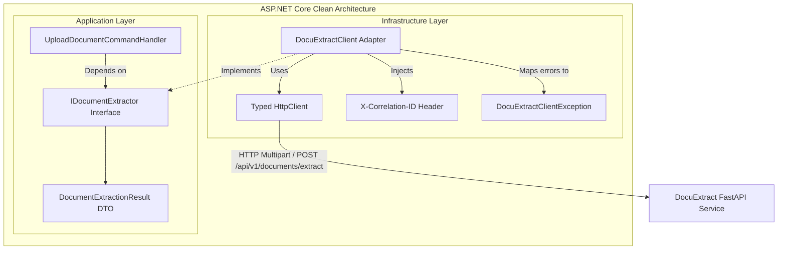

# Kế hoạch triển khai: Phase 5 — Bằng chứng tích hợp ASP.NET Core (ASP.NET Core Integration Proof)

- **Trạng thái:** Hoàn thành
- **Đặc tả liên quan:** `docs/product/requirements.md`, `docs/architecture/architecture.md` (Mục 6), `docs/architecture/api-contract.md`, `AGENTS.md` (Mục 10), Skill `integrate-aspnet`
- **Issue liên quan:** Phase 5 trong `docs/development/roadmap.md`

## 1. Kết quả khảo sát repository

- **Khảo sát bằng CodeGraph và đọc mã nguồn:**
  - `app/api/routes/documents.py`: Endpoint `POST /api/v1/documents/extract` đã hoàn thiện tiếp nhận multipart upload (PDF, DOCX), kiểm tra sớm `Content-Length`, bounded streaming chunks 64 KiB, chuẩn hóa text và trả về `DocumentExtractResponse`.
  - `app/api/routes/health.py`: Endpoint `GET /health` trả về `HealthResponse(status="ok", service="docuextract")`.
  - `app/core/correlation.py`: `CorrelationIdMiddleware` đọc header `X-Correlation-ID` từ request nếu client gửi lên hoặc tự sinh mới, đính kèm vào response header và gán vào `ContextVar` cho logging.
  - `app/core/errors.py`: Mọi lỗi từ chối (`400`, `413`, `415`, `422`, `500`) đều được đóng gói theo error envelope chuẩn: `ErrorResponse(error=ErrorDetail(code, message, correlation_id))`.
  - `docs/architecture/api-contract.md`: Đã có đặc tả hợp đồng API ban đầu, cần được rà soát, hoàn thiện và đối chiếu chính xác 100% với schema OpenAPI thực tế.
  - `docs/operations/service-configuration.md`: Phần ví dụ response `/health` có chút sai lệch (`app_name`, `version` thay vì `status`, `service`), cần đồng bộ lại.
- **Ràng buộc kiến trúc (AGENTS.md Mục 10 & Skill `integrate-aspnet`):**
  - ASP.NET Core sở hữu xác thực, authorization, quy trình nghiệp vụ và lưu trữ dữ liệu.
  - Tầng Application của .NET phụ thuộc vào abstraction `IDocumentExtractor`; không phụ thuộc trực tiếp vào FastAPI hay chi tiết HTTP transport.
  - Tầng Infrastructure của .NET sở hữu adapter typed `HttpClient` (`DocuExtractClient`), xử lý multipart, timeout, cancellation token, phân loại lỗi và correlation ID.
  - Không thêm code .NET trực tiếp vào mã nguồn chạy của Python (`app/`). Tài liệu hóa và cung cấp code mẫu chuẩn mực (C# clean architecture) trong `docs/architecture/aspnet-integration.md`.
  - Thêm integration test trong Python (`tests/integration/test_contract_conformance.py`) kiểm chứng toàn bộ hành vi contract mà client .NET kỳ vọng.

## 2. Phạm vi (Scope)

### Trong phạm vi
1. **Hoàn thiện API Contract (`docs/architecture/api-contract.md`):**
   - Rà soát và chuẩn hóa mọi schema request/response, headers, query parameters, mã lỗi máy đọc được.
   - Bổ sung hướng dẫn chi tiết cho caller .NET về: header `X-Correlation-ID`, multipart payload form field (`file`), streaming timeout, phân loại lỗi.
   - Sửa sai lệch nhỏ trong `docs/operations/service-configuration.md` để khớp với schema `HealthResponse`.
2. **Thiết kế ranh giới tích hợp ASP.NET Core Clean Architecture:**
   - Xây dựng tài liệu hướng dẫn và mã nguồn mẫu C# chuẩn mực (`docs/architecture/aspnet-integration.md`):
     - **Tầng Application:**
       - Interface `IDocumentExtractor` hỗ trợ `Stream`, `fileName`, `contentType`, `CancellationToken`.
       - Application DTOs: `DocumentExtractionResult`, `DocumentMetadataDto`, `ExtractionDataDto`.
       - Phân cấp ngoại lệ đặc tả: `DocuExtractException`, `DocuExtractClientException` (kèm `ErrorCode`, `StatusCode`, `CorrelationId`), `DocuExtractTimeoutException`, `DocuExtractConnectionException`.
     - **Tầng Infrastructure:**
       - Data Contract Models khớp API JSON (`DocuExtractResponse`, `DocuExtractErrorEnvelope`).
       - Adapter Typed `HttpClient` (`DocuExtractClient : IDocumentExtractor`):
         - Đóng gói multipart stream an toàn.
         - Tự động lấy Correlation ID từ `IHttpContextAccessor` hoặc `Activity.Current?.Id` và đưa vào header `X-Correlation-ID`.
         - Truyền `CancellationToken` tới `HttpClient.SendAsync`.
         - Xử lý và phân loại lỗi rõ ràng: Timeout (`DocuExtractTimeoutException`), Lỗi mạng (`DocuExtractConnectionException`), Lỗi nghiệp vụ từ DocuExtract (`DocuExtractClientException`), JSON lỗi (`DocuExtractException`).
         - Đảm bảo Zero Document Logging ở phía .NET client (chỉ log metadata kỹ thuật, thời gian, mã lỗi, correlation ID).
     - **Dependency Injection Registration:**
       - Extension method `IServiceCollection.AddDocuExtractClient(IConfiguration configuration)`.
       - Cấu hình `DocuExtractOptions` (`BaseUrl`, `TimeoutSeconds`, `MaxFileSizeBytes`).
     - **Kế hoạch kiểm thử phía .NET:**
       - Hướng dẫn unit test adapter bằng `MockHttpMessageHandler`.
       - Kịch bản integration test giả lập instance DocuExtract hoặc container.
3. **Bản ghi quyết định kiến trúc (ADR-003):**
   - Tạo `docs/architecture/decisions/ADR-003-aspnet-core-integration.md` ghi nhận ranh giới service-to-service, lý do chọn typed `HttpClient` qua interface abstraction, và chiến lược xử lý lỗi / correlation ID.
4. **Kiểm thử Contract Conformance tự động (`tests/integration/test_contract_conformance.py`):**
   - Viết test suite Python kiểm tra:
     - OpenAPI schema JSON hợp lệ và chứa đủ các endpoints (`/health`, `/api/v1/documents/extract`, `/api/v1/text/analyze`).
     - Correlation ID round-trip: Client gửi `X-Correlation-ID` $\rightarrow$ server trả về đúng ID đó ở cả header và error envelope.
     - Correlation ID auto-generation: Client không gửi `X-Correlation-ID` $\rightarrow$ server tự sinh ID mới ở header và error envelope.
     - Toàn bộ các mã lỗi trong bảng contract (`INVALID_REQUEST`, `FILE_TOO_LARGE`, `UNSUPPORTED_FILE_TYPE`, `INVALID_DOCUMENT`, `ENCRYPTED_DOCUMENT`, `NO_EXTRACTABLE_TEXT`) được kiểm tra tính đồng nhất của envelope.

### Ngoài phạm vi (Explicit Non-Goals)
- Không biến repository Python thành một .NET Solution đa ngôn ngữ.
- Không cấu hình gRPC hoặc event bus (RabbitMQ/Kafka) khi chưa có yêu cầu thực tế được chứng minh.
- Không cấu hình xác thực phức tạp (OAuth2/mTLS) cho môi trường dev cục bộ.

## 3. Thiết kế

### 3.1. Sơ đồ ranh giới Clean Architecture



### 3.2. Bảng ánh xạ mã lỗi giữa DocuExtract và .NET

| HTTP Status | DocuExtract Code | .NET Exception Type | Hành vi đề xuất của ASP.NET Core |
| :---: | :--- | :--- | :--- |
| 400 | `INVALID_REQUEST` | `DocuExtractClientException` | Trả về `400 Bad Request` cho frontend / API consumer. |
| 413 | `FILE_TOO_LARGE` | `DocuExtractClientException` | Báo lỗi file vượt quá dung lượng cho phép. |
| 415 | `UNSUPPORTED_FILE_TYPE` | `DocuExtractClientException` | Yêu cầu người dùng tải lên đúng định dạng PDF hoặc DOCX. |
| 422 | `INVALID_DOCUMENT` | `DocuExtractClientException` | Thông báo file bị lỗi cấu trúc, không đọc được. |
| 422 | `ENCRYPTED_DOCUMENT` | `DocuExtractClientException` | Thông báo file có mật khẩu, yêu cầu mở khóa trước. |
| 422 | `NO_EXTRACTABLE_TEXT` | `DocuExtractClientException` | Thông báo tài liệu không có văn bản (file scan cần OCR). |
| 500 | `EXTRACTION_FAILED` | `DocuExtractClientException` | Log lỗi kèm Correlation ID, trả về `502 Bad Gateway`. |
| - | Timeout / Aborted | `DocuExtractTimeoutException` | Log cảnh báo timeout, trả về `504 Gateway Timeout`. |
| - | Connection Refused | `DocuExtractConnectionException` | Log lỗi kết nối hạ tầng, trả về `503 Service Unavailable`. |

## 4. Các bước triển khai tuần tự

1. [x] **Hoàn thiện API Contract:**
   - Cập nhật `docs/architecture/api-contract.md`: Kiểm tra và đồng bộ hóa các bảng mã lỗi, headers, và hướng dẫn tích hợp.
   - Sửa tài liệu `docs/operations/service-configuration.md` để khớp với schema `HealthResponse`.
2. [x] **Thiết kế tài liệu Tích hợp ASP.NET Core:**
   - Tạo `docs/architecture/aspnet-integration.md` chứa đầy đủ kiến trúc, thiết kế tầng Application/Infrastructure, C# source code hoàn chỉnh và ví dụ test.
3. [x] **Bản ghi quyết định kiến trúc:**
   - Tạo `docs/architecture/decisions/ADR-003-aspnet-core-integration.md`.
4. [x] **Kiểm thử Contract Conformance phía DocuExtract:**
   - Tạo `tests/integration/test_contract_conformance.py` kiểm chứng OpenAPI schema, correlation ID round-trip, error envelope và status codes.
5. [x] **Cập nhật Roadmap & Kế hoạch:**
   - Cập nhật `docs/development/roadmap.md` và kế hoạch này sang trạng thái Hoàn thành sau khi kiểm chứng.
6. [x] **Xác minh toàn diện:**
   - Chạy `uv run ruff format --check .`, `uv run ruff check .`, `uv run pytest`.

## 5. Kế hoạch kiểm thử

| Kịch bản | Mức độ test | Kết quả mong đợi |
| -------- | ----------- | ---------------- |
| OpenAPI Schema endpoint `/openapi.json` | Integration | Trả về 200, chứa đầy đủ các endpoints `/health`, `/api/v1/documents/extract`, `/api/v1/text/analyze`. |
| Round-trip Correlation ID khi client gửi lên | Integration | Response trả về đúng giá trị Correlation ID đó ở header `X-Correlation-ID` và trường error `correlation_id` (nếu lỗi). |
| Sinh Correlation ID mới khi client không gửi | Integration | Response sinh một Correlation ID hợp lệ ở header `X-Correlation-ID`. |
| Khớp cấu trúc Error Envelope | Integration | Mọi lỗi (400, 413, 415, 422, 500) đều trả về định dạng `{"error": {"code": "...", "message": "...", "correlation_id": "..."}}`. |
| Toàn bộ test suite hiện có | Regression | 61 tests hiện có tiếp tục pass 100%. |

## 6. Rủi ro và biện pháp giảm thiểu

- **Rủi ro 1: Sai lệch tên trường giữa Python (snake_case) và C# (PascalCase):**
  - *Biện pháp:* Khai báo rõ thuộc tính `[JsonPropertyName("size_bytes")]` hoặc cấu hình `JsonNamingPolicy.SnakeCaseLower` trong `JsonSerializerOptions` của .NET adapter.
- **Rủi ro 2: Treo request khi tài liệu lớn hoặc mạng chậm:**
  - *Biện pháp:* Thiết lập `HttpClient.Timeout` rõ ràng (mặc định 30 giây) và luôn truyền `CancellationToken` trong adapter C#.
- **Rủi ro 3: Trộn lẫn mã nguồn .NET vào repository Python DocuExtract:**
  - *Biện pháp:* Giữ nguyên tắc phân tách của `AGENTS.md`: Chỉ đặt tài liệu hướng dẫn và mã nguồn mẫu trong thư mục `docs/architecture/`, không làm ảnh hưởng đến môi trường chạy của DocuExtract.

## 7. Tài liệu cần cập nhật

- [x] Tạo `docs/development/plans/2026-11-12-phase-5-aspnet-integration.md` (Kế hoạch này)
- [ ] Tạo `docs/architecture/aspnet-integration.md`
- [ ] Tạo `docs/architecture/decisions/ADR-003-aspnet-core-integration.md`
- [ ] Cập nhật `docs/architecture/api-contract.md`
- [ ] Cập nhật `docs/operations/service-configuration.md`
- [ ] Cập nhật `docs/development/roadmap.md`
- [ ] Tạo `docs/development/dev-logs/dev-log-phase-5.md` (sau khi hoàn thành)

## 8. Lệnh xác minh

```powershell
uv run ruff format --check .
uv run ruff check .
uv run pytest
```

## 9. Phê duyệt / Ghi chú triển khai

- Người duyệt: [Chờ người dùng review và phê duyệt]
- Sai lệch so với kế hoạch: [Chưa có]

